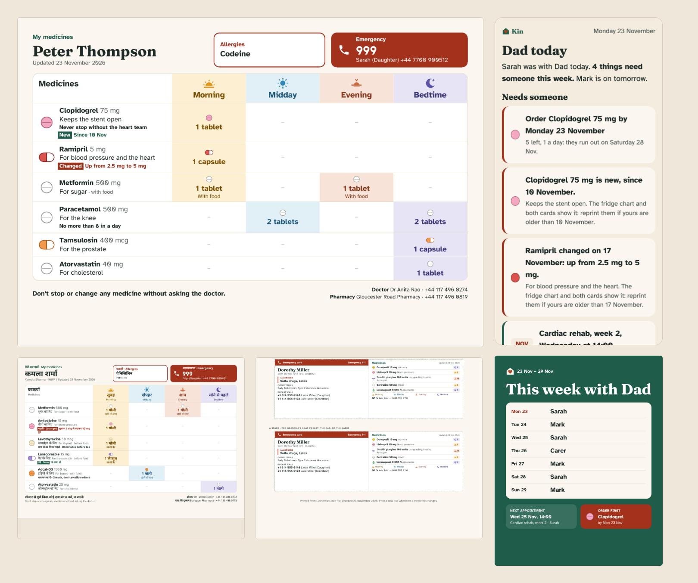
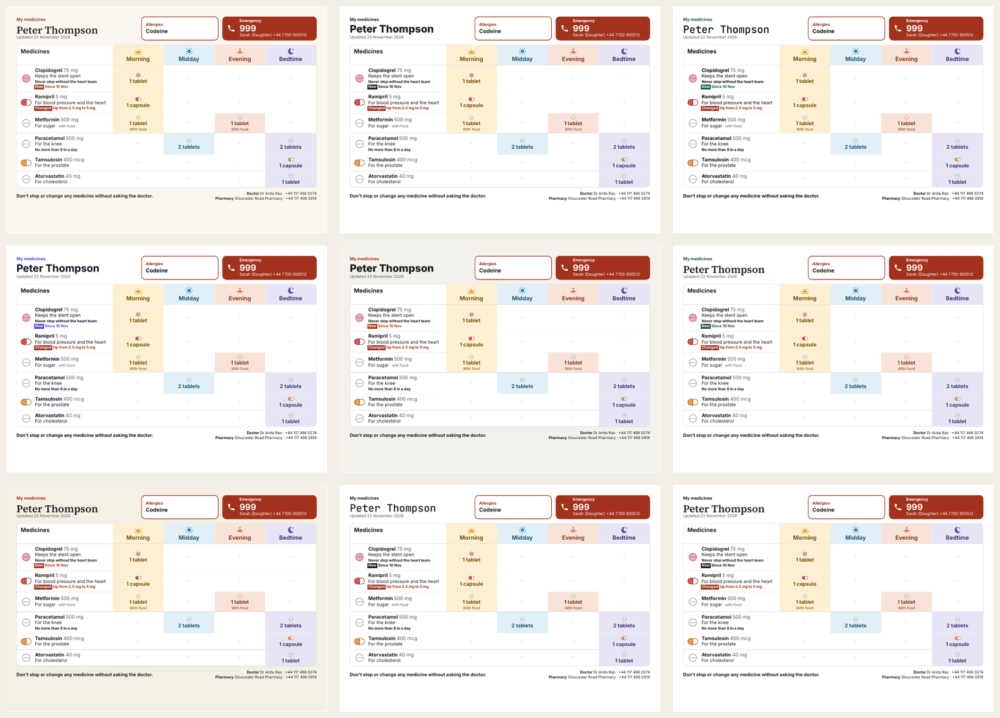
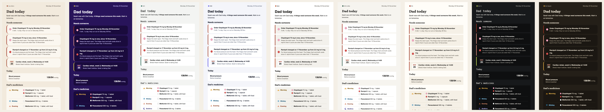
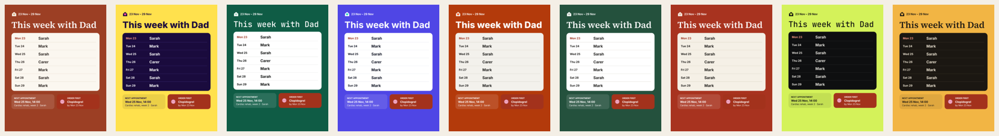
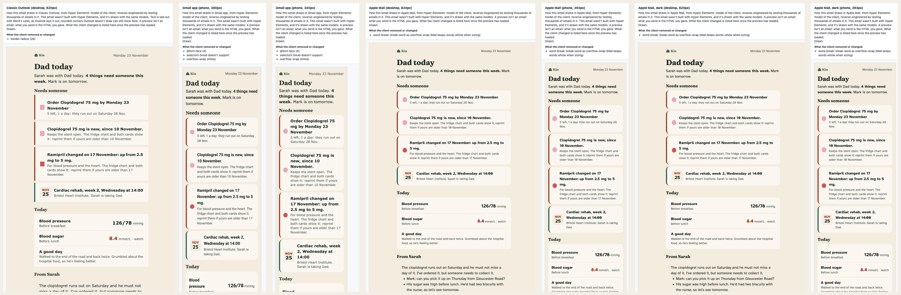

# Kin: a care kit for the family looking after a parent

**[See it live](https://rawsun007.github.io/kin-care-kit/)**: every output for every family, with the PDFs, care pages and emails to open.



When a parent starts needing care, the family ends up with medicine lists in five places: a photo of the pharmacy bag in a group chat, a note in the GP letter, whatever the daughter remembers. The carer needs today's doses, the son who lives away needs to know what's changed, and the paramedic at 3am needs the allergy in one second.

**Kin** is five [Hyper Elements](https://hyperelements.dev) templates that turn **one care file** (a JSON file of medicines, doses, allergies, contacts, appointments and the week's rota) into everything the family needs. It's in English, and **it can also print in the language the parent reads best**, with English beside every line (see below).

| Template | Root | What it's for |
| --- | --- | --- |
| [**Fridge chart**](templates/documents/fridge-chart/template.tsx) | `Document` (A4 PDF) | The day's medicines by time of day, with a drawing of each pill. Page 2 is a week of tick boxes with who's on each day. |
| [**Wallet cards**](templates/documents/wallet-card/template.tsx) | `Document` (A4 PDF) | Two fold-in-half emergency cards, one for the wallet and a spare. Allergies, conditions, medicines, who to call. |
| [**Care email**](templates/emails/care-update/template.tsx) | `Email` | What whoever visited today sends the family: what needs someone this week (refills, dose changes, appointments), today's readings, a word from them, the medicines by time of day. |
| [**Care page**](templates/pages/care-page/template.tsx) | `Page` | The one shared page for the brother abroad, the new carer or the locum GP: everything above, with refill dates and the history of changes. |
| [**Week card**](templates/images/week-card/template.tsx) | `Canvas` (PNG) | A 1080 × 1350 image for the family group chat on a Monday: who's with the parent each day, the next appointment, what to order first. |

Two example families ship with it, each one built end to end in [`examples/`](examples):

- **[Thompson](examples/thompson)**: Peter, "Dad", in Bristol, home after a heart attack. He has a new blood thinner he mustn't miss and a dose that just went up.
- **[Miller](examples/miller)**: Dorothy, "Grandma", in Columbus, Ohio, with early Alzheimer's, insulin in units and eye drops at bedtime.

### Also in the language they read best

Many parents who moved countries read their first language far better than English, more so when they're tired or unwell. Set `"language"` in the care file to `hi`, `ar` or `es`, and the fridge chart and the wallet cards print in the parent's script with English beside every line for the carer and the paramedic. The email, the page and the week card stay in English for the family. Two more examples show it:

- **[Sharma](examples/sharma)**: Kamala, "Amma", in Leicester, who reads **Hindi** (Devanagari).
- **[Haddad](examples/haddad)**: Youssef, "Baba", in Manchester, who reads **Arabic**: the whole chart mirrors right to left.

The care file in every example is made up: names, phone numbers (Ofcom's and NANP's drama ranges), and NHS numbers.

## Run it

Requires Node 20+, Google Chrome (for screenshots and the right-to-left PDFs) and [Poppler](https://poppler.freedesktop.org) (`brew install poppler`) for the PDF previews.

```bash
git clone https://github.com/rawsun007/kin-care-kit && cd kin-care-kit
npm install
npm run check     # hyper-elements check: every design against its template's fields and rules
npm run build     # every paper for every family into examples/, and examples/checks.json
npm run brands    # every template in each of the nine official gallery brands, into docs/brands/
npm run clients   # the care email in classic Outlook, the Gmail app and Apple Mail, light and dark
npm run site      # the GitHub Pages site into _site/ (deployed by .github/workflows/pages.yml)
npx hyper-elements dev templates   # or browse and edit the designs live
```

To make your own family's kit, copy `families/thompson.care.json`, change it, and run `npm run build`. A mistake in the file (a medicine with no dose, a phone number a phone can't dial, no family contact, a dose change dated after the file) stops the build with a message saying what's wrong. **It writes nothing that's wrong.**

## How it uses Hyper Elements

**Every output is a `template()`, in the official gallery's format.** Each template is a factory, `fridgeChart(brand: Brand)`, in `templates/<kind>/<name>/template.tsx`. It takes the gallery's own `Brand` contract ([`_brand.ts`](templates/_brand.ts), copied from upstream). The data is described once in [`_care/fields.ts`](templates/_care/fields.ts) with `prop.*` and shared by all five templates. A family's file is checked by the template before anything is drawn: `prop.text` patterns for strengths (`500 mg`, `2.5 mcg/dose`), phone numbers and times; `prop.choice` for pill forms and colours; `prop.list` bounds (one to eight medicines, two to six contacts); and `guidance` on each field, which the CLI shows to whoever fills the file in. For example: "Never blank. If there are none, write 'None known': a paramedic reads an empty space as 'nobody asked'".

**It drops into the gallery unchanged.** [`npm run brands`](scripts/brands.tsx) builds every template from each of the nine sample brands the official gallery tests its own templates in, and every one checks clean and renders:





Getting there meant a few decisions that fell out of the contrast rule failing on dark brands:

- **Safety colours are fixed.** The emergency number, allergies and dose changes use one fixed set of colours, and the four times of day keep their colours too. A brand's accent is often decorative (Orbit's is teal, Slow Signals' is amber), and an allergy must never be printed in a colour nobody can read.
- **Dark brands get light inks.** On a dark background, the alert and time-of-day inks switch to light versions that still pass AA.
- **Paper is always white.** A dark brand keeps its type and colours on the PDFs, but prints dark ink on light paper: toner on a black A4 page is unreadable and costs a cartridge.

**Accessibility rules are required, not suggested.** The email requires these `@hyper-elements/lint` rules:

- contrast, text-size, lang, dir;
- link-text, link-empty, image-alt, alt-text;
- heading-order, heading-one, preview-text.

The page requires those plus `title`. A design that breaks one doesn't build. The fonts were chosen for the reader:

- **[Atkinson Hyperlegible](https://www.brailleinstitute.org/freefont/)** for body text: the Braille Institute made it for low-vision readers.
- **Body text is 18 px** in the Kin brand.

**The email is a real template, with blocks and a slot.**

- **`log` is a `prop.blocks` field** with three block types, each with its own fields:
  - a reading: blood pressure, sugar, weight, temperature or oxygen, each with a value pattern and a "watch" flag;
  - a mood;
  - a note.
- **`word` is a `field.slot`.** "From Priya" lets whoever visited write freely, but only in `Text`, `List` and `Link`, with `styles: "none"` and a count limit. They can't break the layout or restyle the email.
- **The preview text is computed** from what needs someone this week. A designer can't forget it.

**Layout and fit are checked, and the fridge chart refuses to overflow.** The fridge chart estimates its height from the medicines and their notes. If they don't fit, it switches to a denser layout. If they still don't fit, it throws: *"don't fit on one fridge page, and a medicine cut off a chart is worse than none"*. A thrown error is a template error in Hyper Elements, so the build stops. The templates also require these checks:

- `layout/overflow` and `document/overflow` on the papers;
- `image/overflow`, `image/glyph` and `image/fit` on the Canvas (whose heading uses `fit` sizes).

**Every root is used, with one data file.**

- `render()` draws the HTML for the `Email` and the `Page`.
- `renderPdf()` from `/pdf` draws the `Document`s.
- `renderImage()` from `/image` draws the `Canvas`, and also the slot icons and the logo in [`assets/`](assets) ([`scripts/icons.tsx`](scripts/icons.tsx)).
- The pill drawings are `Svg` with titles, drawn the same way in all four outputs.

**Email clients.** [`npm run clients`](scripts/clients.tsx) renders the care email with `@hyper-elements/email-clients` in seven previews, with **0 errors**:

- classic Outlook;
- the Gmail app on Android and on an iPhone;
- Apple Mail on a Mac and an iPhone, light and dark.



## Three scripts, three problems solved

**Devanagari in PDFs.** In react-pdf, Hindi lost the vowel signs at the end of a word: "न बदलें।" printed as "न बदल◌े". The cause is that fontkit caches each glyph with the characters of its first use. When the same glyph shapes a different cluster later, the text layout slices the string wrong. [`scripts/pdf-setup.ts`](scripts/pdf-setup.ts) patches `getGlyph` to return a glyph with the right characters. Import it before `renderPdf()`.

**Arabic in PDFs.** The PDF renderer shapes Arabic correctly but places right-to-left lines a few points to the right, so their first letter is clipped: "قبل" reads as "تبل". For a right-to-left family, [`build.tsx`](scripts/build.tsx) prints the same `Document`'s HTML from `render()` to PDF with Chrome. It's the same template and checks, shaped by a browser. The templates set `dir` on the root and keep English runs left to right inside (`dir="ltr"`, phone numbers in Unicode isolates), so the whole chart mirrors: Arabic on the right, the times of day reading right to left.

**Arabic in images.** The image renderer doesn't reorder the words of right-to-left text yet. So the language pack marks Arabic `canvas: false`, and the week card falls back to English for it rather than print words in the wrong order. Hindi and Spanish work in images.

Both Arabic issues are worth reporting upstream; minimal repros are easy to make from the families here.

## Layout

```
families/                 one care file per family: the only thing a family edits
templates/
  _brand.ts               the gallery's Brand contract (MIT, from hyper-elements)
  _brands/kin.ts          Kin's brand; _brands/gallery/ the nine sample brands
  _care/                  shared fields, the date and supply logic, the languages, pill and icon drawings
  documents/fridge-chart  documents/wallet-card  emails/care-update (+ designs/)  pages/care-page  images/week-card
scripts/                  build, brands, clients, hero, site; fonts, screenshots, the PDF fix
site/index.tsx            the GitHub Pages landing page, itself a Hyper Elements Page
examples/                 every output for every family, and checks.json
docs/                     the images in this README
```

## A note on the translations and the medicine

The Hindi, Arabic and Spanish in the language packs and the Hindi and Arabic example families are a careful first draft. **Have a native speaker read them** before a family relies on them. Kin is not medical advice: the GP and the pharmacist have the last word on every dose, and every paper says so.

## License

MIT. `templates/_brand.ts` and the sample brands in `templates/_brands/gallery/` are from [hyper-elements](https://github.com/hyper-elements/hyper-elements), under its MIT license. Fonts are under the SIL Open Font License: Atkinson Hyperlegible, Fraunces, Noto Sans Devanagari and Noto Sans Arabic.
